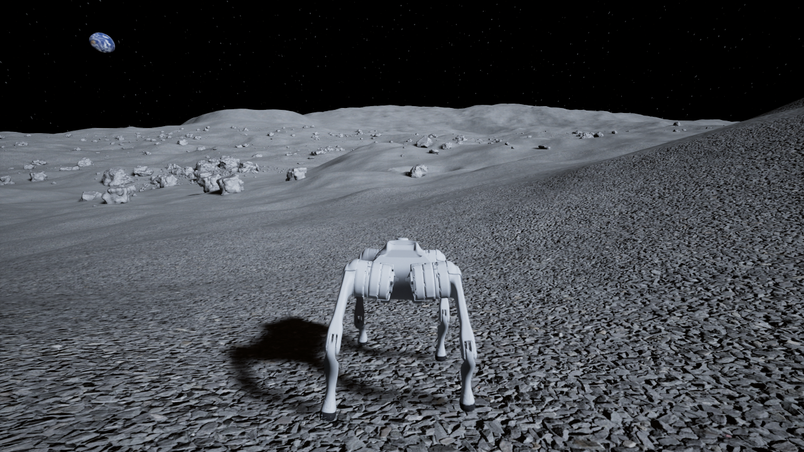

# LunarGo2 — UE 5.7 + MuJoCo

宇树 Go2 在月面地形上的实时行走演示。UE 负责画面，MuJoCo 负责机器人动力学和地形接触，ONNX Runtime 执行已有的 Go2 行走策略。

**朋友直接体验：下载 Linux 发布包、解压、运行 `run.sh`。无需安装 UE 编辑器、Python、ROS 或训练环境。**



## Linux 快速开始

打开 [Releases](https://github.com/Xundendong/LunarGo2/releases)，下载 `LunarGo2-linux-x86_64.tar.gz`：

```bash
tar -xzf LunarGo2-linux-x86_64.tar.gz
cd LunarGo2-linux-x86_64
./run.sh
```

也可以通过仓库脚本下载：

```bash
git clone https://github.com/Xundendong/LunarGo2.git
cd LunarGo2
./download.sh
```

需要有桌面的 Linux x86_64 系统、支持 Vulkan 的独立显卡以及已安装的显卡驱动。发布验证以 Ubuntu 24.04 为准；初次加载需要等待着色器和地形资源就绪。

## 操作

| 按键 | 动作 |
|---|---|
| W / S | 前进 / 后退，目标速度 1 m/s |
| A / D | 左转 / 右转 |
| 松开 WASD | 停步 |
| R | 回到出生位置 |
| 鼠标右键拖动 | 调整后方相机视角 |
| 滚轮 | 相机拉近 / 拉远 |
| Esc | 退出 |

默认是机器人后方跟随视角。太阳高度 35°；地球是原资产的 3 倍视觉大小；碎石纹理为最初尺度的 40%。这些是展示参数，不是天文标定。

## 当前范围

- 这是月面**外观与地形行走演示**，不是已验证的月面重力控制基准。
- 现有策略使用 **9.81 m/s²** 重力；换成月面重力需要重新适配控制策略。
- MuJoCo 地形碰撞覆盖原点周围 **300 × 300 米**。请留在此范围内。
- 场景中的独立石头是视觉装饰，尚未接入 MuJoCo 障碍碰撞。
- 此仓库只发布 Go2 演示，不包含 LunarHumanoidBench 原来的双臂、人形机器人任务。
- WebM 录屏可以转成 MP4；应用本身不会逐帧写图片，避免录制导出拖慢交互。

## 源码构建

见 [构建说明](docs/BUILD.md)。源码可公开；可编辑的付费月面资产不包含在 Git 仓库中。复现此地图需要自己拥有 [Moon Landscape Open World](https://www.fab.com/listings/dea3878b-b56c-4c3b-880a-34dbe3ef778e)。发布包包含的是完成的应用，并不授予素材转售或独立分发权限。

代码采用 MIT；依赖、机器人模型、策略及商业素材分别遵循其原授权，见 [第三方声明](THIRD_PARTY_NOTICES.md)。
